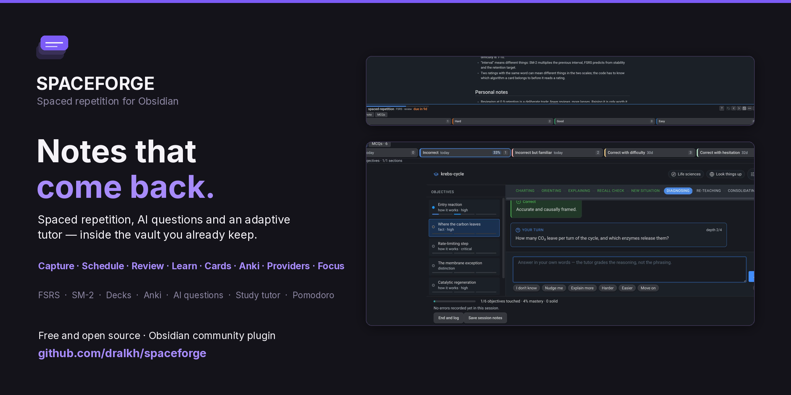
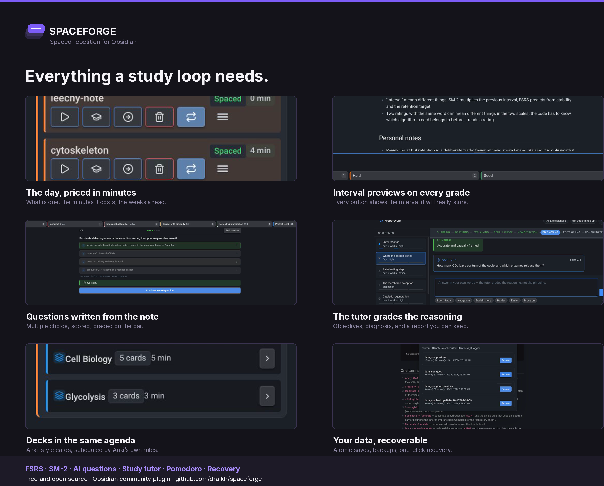

# Spaceforge: Advanced Spaced Repetition & AI-Powered Study Plugin for Obsidian

**Spaceforge: Your ultimate Obsidian plugin for efficient knowledge management, memory retention, and exam preparation. Featuring advanced spaced repetition (FSRS & SM-2), AI-powered MCQ generation, and an integrated study Pomodoro timer.**

Spaceforge transforms your Obsidian notes into a powerful learning and revision tool. It enhances your learning workflow by providing intelligent flashcards, automated multiple-choice question generation, and focused study sessions, all designed for optimal memory retention and active recall.



## Preview

https://github.com/user-attachments/assets/42cdccfe-6865-4942-bc6d-cd9e0376e071




## Key Features

*   **Advanced Spaced Repetition & Smart Flashcards:**
    *   Master active recall with cutting-edge spaced repetition algorithms: **FSRS (Free Spaced Repetition Scheduler)**, a modern, scientifically optimized algorithm for maximum memory retention, or an **enhanced SM-2 algorithm** for efficient review scheduling.
    *   Customize your learning journey with tailored scheduling parameters, turning your notes into intelligent flashcards.
*   **AI-Powered MCQ Generation & Quiz Creation:**
    *   Effortlessly create Multiple Choice Questions (MCQs) directly from your Obsidian notes, transforming them into interactive quizzes.
    *   Leverage powerful AI models from various providers: **OpenAI, OpenRouter, Ollama, Gemini, Claude, and Together** for intelligent question generation.
    *   Seamlessly configure API keys and AI models within the plugin settings for personalized quiz creation.
    *   **Updated scoring system** that deducts full marks on initial incorrect attempts for better learning assessment.
*   **Study: an adaptive tutor for a single note:**
    *   Charts a note into **atomic learning objectives** once, then teaches them one at a time through explain → recall → apply, diagnosing *why* an answer was wrong rather than only that it was.
    *   Tracks understanding, recall and transfer separately per objective, and only counts recall as durable when it was produced on **two different days**.
    *   Remembers everything between sessions: reopening Study resumes at the objective that actually needs work, with the tutor's notes on what you keep confusing.
    *   **One workspace per note**: Learn, Visualize, Mind map and Summary share a single surface, and each objective keeps its own conversation and draft — switching objectives never loses an answer. A pending question or the last session report is restored when you come back.
    *   **Domain-aware**: the same engine adapts to medicine, law, mathematics, languages, music theory, practical skills and everything else, and you can correct its reading of the subject.
    *   **Optional web lookup** to verify mechanisms and current facts mid-session, with citations restricted to sources actually retrieved.
    *   Session results feed straight back into the spaced-repetition schedule, and a report can be written into your vault as study notes and cards.
*   **Integrated Pomodoro Timer:**
    *   Boost productivity with a built-in Pomodoro timer.
    *   Customize work, short break, and long break durations.
    *   Track sessions and manage your focus directly within Obsidian.
*   **Comprehensive Review Management:**
    *   A dedicated sidebar view displays upcoming reviews, estimated completion times, and allows for easy navigation with configurable hotkey support.
    *   Calendar view for visualizing your review schedule with standardized UTC date calculations.
*   **Progress Statistics:**
    *   A statistics page (run "Spaceforge: Open statistics", or click the chart button in the sidebar header) puts the whole vault in one dashboard: reviews today, streaks and days studied, an activity heatmap (the last six months, or a year on the wide windows) with a weekday-rhythm card and a click-through day breakdown, a 30-day due forecast for notes and Anki decks, Anki-style **true retention** by maturity, the answer-button mix, interval/ease/stability/difficulty distributions, a memory-now estimate for FSRS cards, the leeches worth refactoring, per-deck summaries, and the tutor and quiz summaries.
    *   Built to last: each review folds into a permanent per-day counter, so year-long heatmaps, streaks and all-time retention survive even though the detailed review log keeps only the newest 1000 entries. Deck answers (with their answer times) are written to an Anki-style review log, which is what lets deck retention and answer-time figures exist at all.
*   **📅 Calendar Events Organization:**
    *   **Full Event Management**: Create, edit, and delete calendar events with comprehensive CRUD operations
    *   **Event Categories**: Color-coded categories (Work, Personal, Study, Meeting, Health, Social, Other) for visual organization
    *   **Recurring Events**: Support for daily, weekly, monthly, and yearly recurrence patterns with end dates
    *   **Visual Event Display**: Events shown as colored tabs in calendar cells with hover interactions
    *   **Upcoming Events List**: Organized list of upcoming events below calendar grid with day-based grouping
    *   **Quick Event Creation**: Hover plus button on calendar days for fast event creation with pre-filled dates
    *   **Event Details Modal**: Comprehensive event creation/editing interface with all event properties
    *   **Real-time Updates**: Calendar refreshes instantly after event operations with proper state management
*   **Flexible Note Addition:**
    *   Add individual notes or entire folders to your review schedule via the right-click context menu.
    *   Use Obsidian commands to add the current note or its folder.
*   **Centralized Data Management:**
    *   All review schedules and plugin data are stored centrally, keeping your note frontmatter clean.
    *   Option to specify a custom data path for your Spaceforge data with automatic migration from legacy storage locations.
    *   Enhanced data integrity verification and file cleanup processes ensure reliable performance.
*   **Optimized Performance & Reliability:**
    *   Streamlined application logging eliminates unnecessary console noise
    *   Improved error handling with reduced redundant warning messages
    *   Consistent UI styling using Setting components throughout the application
    *   Optimized build configuration with focused TypeScript inclusion patterns

## Getting Started: Install & Configure Your Obsidian Study Plugin

1.  **Installation:** Easily install Spaceforge directly from the Obsidian Community Plugins browser. Alternatively, for manual installation or development:

```bash
# Clone the Spaceforge repository
git clone https://github.com/dralkh/spaceforge.git
cd spaceforge

# Install dependencies, build the plugin, and deploy to your Obsidian vault
npm install && npm run build && node install.js --d /home/user/Documents/vault/.obsidian/plugins

```

2.  **Configuration:** Optimize Spaceforge for your learning style:
    *   Access the Spaceforge settings within Obsidian.
    *   Select your preferred Spaced Repetition Algorithm (FSRS is highly recommended for its efficiency).
    *   For AI-powered MCQ Generation, choose your desired AI provider (e.g., OpenAI, Gemini) and input the necessary API key and model details.
    *   Personalize Pomodoro timer durations to fit your study habits.

> **Disclaimer:** When updating Spaceforge, please ensure you preserve your `data.json` file, which contains all your review schedules and MCQ questions. Spaceforge strives to maintain backward compatibility, and version 1.0.1 includes automatic migration from legacy data storage paths to current locations.

### How to Use

#### Adding Notes to Review
*   **File Explorer:** Right-click on a note or a folder in the file explorer and select "Add to review schedule."
*   **Automatic linking heirachy:** Notes will be based upon main folder name note which all links would go through serially, if none is found it will find note with most links to be main focal point of the specific folder. Outgoing link to be included but not its concurrent folder's notes.
*   **Command Palette:**
    *   Use "Spaceforge: Add Current Note to Review Schedule."
    *   Use "Spaceforge: Add Current Note's Folder to Review Schedule."

#### Reviewing Notes
Notes are reviewed in place. The note opens as a normal note and the grading controls sit in a bar docked underneath it, the way Anki and SuperMemo present cards: read the item, enter the grade, and the next due note loads in the same tab. Nothing covers the note and no panel has to be reopened between items.
1.  Open the Spaceforge sidebar (usually on the right, or activate via the ribbon icon). The sidebar lists the notes due for review.
2.  Click the "Review" button on a note, or run `Start review session` to work through everything that is due. The first due note opens with the review bar under it.
3.  Read the note, then enter a grade: click a grade button or press its number key. Each button shows the interval it would schedule, so the effect of the choice is visible before it is made.
4.  The next due note opens straight away and the bar updates in place. A grade that fails a note keeps it in today's queue, so it comes back after the other notes have been answered — the same-session drill Anki and SuperMemo use — and the run ends once everything has been passed; `Esc` or the ✕ ends it early.
5.  A note that keeps failing is the one thing that stops the flow: at each lapse checkpoint (8 by default) the bar asks whether to reset the note's progress, rest it for a week, remove it from the schedule, or carry on.

How the intervals behave (nothing here is an estimate — the buttons preview what the scheduler will actually store):

*   **FSRS notes** are scheduled by FSRS itself, the same model Anki's FSRS runs: Again, Hard, Good and Easy each move the stability estimate their own way, and a review that arrives late grows the next interval rather than resetting it. Again sends the card to a short term relearning step *today* (a few minutes), and passing it again in the same session graduates it back to a normal interval.
*   **SM-2 notes** follow SuperMemo 2 as published: `I(n) = I(n-1) × EF`, with `I(1) = 1 day`, `I(2) = 6 days`, `EF` updated per grade and floored at 1.3. A grade below 3 restarts the repetition schedule and re-asks the note today. How long the note has been due is deliberately *not* an input — SM-2 has no lateness penalty, so answering an overdue note well schedules it exactly as if it were on time.
*   **New notes** walk the initial steps (0, 3, 7, 14, 30 days by default) with the grades meaning what they mean in Anki: Hard repeats the current step, Good advances one, Easy graduates the note on the spot, and a failure drops back to the first step.
6.  **Study and questions sit in the same dock under the bar** (the `Study` and `MCQs` buttons), and the dock's height is yours to drag — grab its top edge, double-click it to go back to the default. Neither one opens a window over the note.
7.  A sitting reports what it scored and leaves the grade to you: the four grades wait next to the score, with the grade the score implies marked *suggested*. Set **Settings → Multiple choice questions → Grade after a set of questions** to *Apply the score-derived grade* if you would rather it be recorded the moment the last question is answered. Either way, grading a sitting keeps you on the note — nothing walks you into the next review because you finished some questions.

Keyboard while a session is running: `1`-`4` grade (FSRS), `0`-`5` grade (SM-2), `n` skips the note, `p` postpones it a day, `u` undoes the last rating, `Esc` ends the session. While the caret is in the text the digits type normally; hold `Alt` to grade from there. The grade commands can also be bound to any keys you like in Obsidian's hotkey settings.

Reviews are always docked: the note stays in view and the grades sit in a bar under it. (The older dialog that opened *over* the note is gone; a vault that still had it selected is moved to the bar the next time its settings load.)

#### Reviewing Your Progress (Statistics)
Run **"Spaceforge: Open statistics"**, or click the chart button beside the List | Calendar | Review toggle in the sidebar header. The page opens in a tab of its own (usable in a second pane or a popout window) and is a compact grid of charts, in the spirit of Anki's statistics screen:

1.  **Six figures up top**: reviews today (with the 7-day average), the streak and its best, retention over the last 30 days, what is due today and overdue, the share of days studied in the chosen window, and — for FSRS material — how much of it is recallable right now, with the estimated number of items behind that percentage.
2.  **Activity**: the heatmap of the last six months (a year on the wide windows), one cell per day, darker with more reviews, plus a legend. Hover any cell for its count; click one to turn the card beside it into that day's full breakdown — notes and deck cards, and the Again/Hard/Good/Easy split — with one click back to the weekday rhythm.
3.  **Details**: the weekday rhythm of the chosen window by default (which days carry the studying), or the picked day's breakdown.
4.  **Next 30 days**: a forecast of due reviews, notes under and deck cards over, with overdue folded into today, today's column marked, the average per day, Anki's daily-load estimate, and the new cards waiting to be introduced. Hover a bar for that day's numbers.
5.  **Retention**: true retention by maturity — learning steps, young (scheduled under 21 days) and mature (21+ days) cards, plus the two combined — over today, a week, a month and all time. Again is the only failure, exactly as FSRS counts it, so a Hard grade is a pass here as it is there.
6.  **Answer buttons**: the Again/Hard/Good/Easy mix for the window, with the Again rate split by maturity — the closest thing to a "this material is not sticking" alarm.
7.  **Collection health**: the distribution of intervals, ease, FSRS stability and FSRS difficulty across notes and decks, with the median marked; a long tail pools into a single `Nd+` bar instead of flattening the shape. Switch metrics with one click.
8.  **Decks** and **Study**: per-deck summaries (due, queue mix, maturity, 30-day retention, answer time) that open the deck on click; and the tutor's objectives, session minutes, average score and recurring error categories beside the quiz accuracy.
9.  **Needs attention**: the leechy notes (lapses and recent Again counts) and decks (cards at the leech threshold), each with a severity dot, clickable so the note or deck is one click away.

The window selector (1 month / 3 months / 1 year / All) drives the activity, button-mix and days-studied figures; retention and the distributions are already period-based and snapshot-based respectively.

Two honesty notes about the data: when you first upgrade, the day counters are seeded once from the *existing* review log (up to the newest 1000 reviews — older history that the log no longer holds cannot be recovered), and the deck review log only starts with the first deck card you answer afterwards. Everything is computed locally from your vault; nothing leaves your machine.

#### Studying a Note (Adaptive Tutor)
1.  Start a review (or right-click a note, or click the graduation-cap button on its sidebar row, or use "Spaceforge: Study current note"). During a review, **Study** is a button in the dock under the bar, beside **MCQs**: study mode expands below the bar, and the note you are being tested on stays on screen the whole time. Nothing opens on top of what you are already looking at.
2.  The first time a note is charted it is done in the background, a few sections at a time — a long clinical chapter is several model calls, and none of them block the editor. The sidebar shows what is being charted and can pause or retry it. Charting resumes where it stopped if Obsidian is closed mid-way, and one section failing does not lose the others.
3.  The briefing shows where you stand: how many objectives exist, which are solid, which are fragile, and which are due. Below it, every figure in the note is listed as a thumbnail — click one to preview it, and the tutor refers to them by name while it teaches.
4.  Pick how the session should run — **Guided** (explain → recall → apply), **Rapid drill**, **Repair** (attack recurring errors), **New situations** (transfer only) or **Exam block** (feedback withheld until the end) — and whether the tutor may look things up on the web.
5.  Answer in your own words. The tutor grades the reasoning, names the specific mistake (recall failure vs. confusion vs. overlooked detail) and adjusts what comes next; the objective rail on the left fills in as it goes. Number keys or A–I pick a choice when the tutor offers options.
6.  Switch objectives with the chooser under the header (or the rail on a wide panel). Each objective keeps its own conversation and draft, so moving between them never loses an answer; a note with a pending question or a draft resumes where you stopped.
7.  Finish with a summary you can save into the vault as study notes and cards. The note's review schedule is updated from the same result unless you turn that off in settings. The last report is restored when you reopen the note.

Notes are charted once and then only re-charted if you ask or if the note changes; your mastery follows the objectives it belongs to. Objective reviews are suggested by the session and shown in the briefing and the report, and they are labelled as suggestions rather than a proven optimum.

Charting obeys **Objectives per note**: when a note holds more than that, the most important objectives are kept and the remaining sections are left uncharted (and said so, rather than silently dropped). Long notes are split at headings, figures are carried along with the text, and a section whose reply is cut off is retried in halves before it is reported as failed.

#### Using the Pomodoro Timer
1.  Access Pomodoro controls from the Spaceforge sidebar.
2.  Start, pause, reset, or skip Pomodoro sessions (Work, Short Break, Long Break).
3.  The timer and current session type are displayed in the sidebar.

#### Managing Calendar Events
1.  **Create Events**: Click the plus button in the calendar header or hover over calendar days to reveal the quick-add button
2.  **View Events**: Events appear as colored tabs in calendar cells and in the upcoming events list below the calendar
3.  **Edit Events**: Double-click event tabs in calendar cells to open the edit modal
4.  **Delete Events**: Use the delete button in the edit modal (no confirmation required for quick workflow)
5.  **Event Categories**: Choose from predefined categories with automatic color coding or set custom colors
6.  **Recurring Events**: Set recurrence patterns (daily, weekly, monthly, yearly) with optional end dates
7.  **Event Details**: Add title, description, date, time, location, and category for comprehensive event management

#### Studying a deck (Anki cards)

Spaceforge keeps a second, separate lane for Anki-style cards. A deck is a file you can read and
edit like any other note, under `spaceforge/decks/`, and its images live beside it in
`spaceforge/decks/media/`. Nothing about it is hidden in a database: open the file and you will see
the deck's options in its frontmatter, one section per card with its question and answer, and a
small state line per card that carries its schedule.

Cards come in four shapes. A question and an answer is a **flip** card; a note with two cards asks
the pair both ways (the **flip matrix**); options written as a list between the question and the
answer make it **multiple choice**; `{{c1::text}}` in the card's text makes it a **cloze**; and a
card can ask for a **typed answer**, compared the way Anki compares it (exactly, unless the card
allows case or accent differences). To add a card by hand, write a new `## ` section with `**Q**:`
and `**A**:`, exactly like the ones above it.

Import a `.apkg` from Anki with **Import an Anki deck**, study decks with **Study a deck** (in the
pane, or **in a new window** for a second monitor), and hand a deck back to Anki with **Export a
deck as an Anki package**. Cards are scheduled with Anki's own rules — learning steps, graduation,
ease, lapses, leeches, daily limits, burying — so a deck imported from Anki keeps the due dates it
arrived with, and a deck exported to Anki behaves there as it did here. An exported package carries
the deck's notes, cards, media and each card's schedule (including the review history that decides
it); the per-review log Spaceforge keeps for its own statistics screen is not rebuilt into the
package — Anki writes a fresh log for the reviews you do on its side. Every card you answer here is
logged (grade, intervals, ease, answer time), which is what the statistics page's deck figures read.
The calendar shows what the notes owe and what the decks owe side by side, so a day with both is
never a surprise.

If Anki is running on the same computer, the deck can stay in step with it without any exporting:
turn on **Sync with Anki in the background**, which needs the AnkiConnect add-on, and every few
minutes each deck is pulled from Anki, merged card by card, and pushed back. The push is skipped
when the deck has not changed since the last one, and a deck of thousands of cards goes over in
slices, because Anki's importer is slow — and on a very large package, refuses — when handed
everything at once. Both sides keep their own schedule authority: answers recorded in either app
reach the other, along with the due date and the ease factor. Anki's interval and rep counts are
rebuilt by Anki's own scheduler from its state, so a card can shift by a day when it is first
answered there. Nothing leaves the machine — the add-on answers on the loopback interface — and the
bridge is offered only in the desktop app, since a phone has no Anki to talk to.

**Progress can travel inside the vault too.** A vault can be synced without its `.obsidian`
folder — which is where every plugin's settings live — and then nothing about your reviews would
follow you to another device. Turn on **Carrying progress between devices → Carry progress with the
vault** and a copy of your review progress and shared preferences is kept at
`spaceforge/state/progress.json`, inside the vault, and merged on load. Merging is per note, so two
devices keep each other's reviews and the newest review of a note wins; the settings that name your
machine (Anki's address, a custom data path) and anything that holds a credential never travel. A
device that opens the vault without a data file of its own adopts the copy, so a reinstall or a new
phone starts where you left off rather than empty.

## Core Concepts

### Scheduling Algorithms: Optimize Your Learning
*   **FSRS (Free Spaced Repetition Scheduler):** A cutting-edge, modern algorithm rooted in memory science that dynamically optimizes your review intervals for maximum retention and learning efficiency. Customize FSRS parameters in settings to fine-tune your spaced repetition system.
*   **SM-2 (SuperMemo 2):** The classic algorithm, implemented as published: the grade and the previous interval decide the next one, the ease factor follows the original formula with its 1.3 floor, failed items restart from `I(1) = 1 day` and are drilled again the same session. Overdue reviews are scheduled on their merits; lateness is not punished, because SM-2 never had a lateness term (FSRS is the model that accounts for elapsed time, which is one reason to prefer it for new notes).

### AI-Powered MCQ Generation: Create Quizzes from Your Notes
Spaceforge seamlessly integrates with various AI services to automatically generate Multiple Choice Questions from your note content. This powerful feature transforms your study material into interactive quizzes, providing an alternative and effective way to test your understanding and reinforce learning. Ensure your chosen AI provider is configured correctly in the settings to unlock this intelligent quiz creation capability.

## Settings Overview

The Spaceforge settings tab allows you to customize:
*   **General Settings:** Default review views, notification preferences, navigation hotkeys.
*   **Scheduling Algorithm:** Select and configure FSRS or SM-2 parameters with standardized UTC date calculations.
*   **MCQ Generation:** Enable/disable MCQs, select API provider, enter API keys and models, configure scoring behavior.
*   **Study:** Enable/disable the adaptive tutor, set the starting level and tutor language, cap objectives per note and turns per session, choose whether session results update the review schedule, configure the web-lookup provider (Tavily, Brave, SearXNG or a custom endpoint), and control background charting — whether notes are charted as they are added to review, how many sections are charted per pass, and a button to chart everything scheduled right now.
*   **Pomodoro Timer:** Enable/disable, set durations for work/break sessions, sound notifications.
*   **Calendar Events:** Enable/disable calendar events, set default event category, configure event display options.
*   **Data Management:** Set a custom path for plugin data, import/export data, manage data integrity.

## Upgrading to 1.1.0

Your data comes across untouched: every schedule, review, question set and chart is preserved, and
nothing is asked of you. One behaviour changed. **Charting notes ahead of time is now off by default**
— it used to chart every note you added to review in the background, which spends model calls on notes
you may never open. With it off, the note in front of you is charted the moment you open its Study
panel, and its questions are written when you ask for them: same result, one note at a time, on
demand. If you preferred the old behaviour, turn **Chart notes ahead of time** back on in Settings →
Spaceforge → Study, and it stays on.

## Commands & Shortcuts

Deck commands: **Import an Anki deck (.apkg file)**, **Study a deck**, **Study a deck in a new
window**, **Export a deck as an Anki package**, **Find a deck on AnkiWeb**.

Spaceforge adds these commands to the Obsidian command palette (22 in all). Every one is bindable
under Settings → Hotkeys, search "Spaceforge"; **none ship with a default hotkey**, so nothing you
have already bound can be taken over.

*   `Spaceforge: Next note` / `Spaceforge: Previous note`
*   `Spaceforge: Start review session`
*   `Spaceforge: Open statistics`
*   `Spaceforge: Review this note` / `Spaceforge: Study this note`
*   `Spaceforge: Chart this note` / `Spaceforge: Chart scheduled notes`
*   `Spaceforge: Open the study dock` / `Spaceforge: Open the questions dock`
*   `Spaceforge: Rate this note: again / hard / good / easy` (shown while a session is running)
*   `Spaceforge: Undo the last rating` / `Spaceforge: Skip this note` / `Spaceforge: End the session`
*   `Spaceforge: Add this note to review` / `Spaceforge: Add this folder to review`
*   `Spaceforge: Add the selected file to review`
*   `Spaceforge: Recover review data` / `Spaceforge: Repair schedules from history`

Commands that need an open note are hidden — not greyed — in the palette when none is open.


## Privacy, network use and access outside the vault

Spaceforge is local-first: your notes, review history, study progress and calendar events live in
your vault. Nothing is sent anywhere unless you start a task that needs a model, and then only the
text of that task goes to the service you chose. Charting and question writing are on demand: they
begin when you open a note's Study panel or ask for its questions, never on their own as you browse.
If you turn on **Chart notes ahead of time**, scheduled notes are then charted in the background
instead (a few sections per pass).

**Remote services this plugin can contact** (all optional, and each one only when it is the
provider you selected for a feature):

| Service | Used for | When |
| --- | --- | --- |
| Any model provider you choose in Settings — OpenRouter, OpenAI, Google Gemini, Anthropic Claude, Together AI, xAI, Mistral, DeepSeek, Groq, Fireworks, Cohere, MiniMax, MiMo, Z.AI, Moonshot, NanoGPT, OpenCode Zen/Go, Azure OpenAI, a local LM Studio or Hermes gateway, or any OpenAI-compatible server you configure | Writing questions from a note, and the adaptive tutor's explanations, questions and grading | Only while a generation, study session or charting run is in progress |
| The model-list endpoint of that same provider (`/models`) | Filling the model picker in the settings so you do not have to type a model id from memory | Only when you press **Find models** or **Detect** |
| Ollama or another local server you point the plugin at (`localhost`) | Same as above, but nothing leaves your machine | Only when you press the buttons above |
| Tavily, Brave or SearXNG | Web lookups the tutor may make when a session allows them (off by default) | Only during a study session that has web lookup enabled |
| The agent CLI you select, if you use **Local agent CLI** as the provider (the CLI then contacts whichever service it is signed in to, under its own account) | Same tasks, run through a CLI on your machine | Only while a task runs |
| AnkiWeb (`ankiweb.net`) | Searching shared decks, reading a deck's page, and fetching a deck you ask to import | Only while the AnkiWeb search window is open, or when you press **Import** on a deck in it |

**Access outside your vault.** The optional **Local agent CLI** provider runs a program that is
already installed and signed in on your computer (for example `claude`, `codex`, `copilot`,
`cursor-agent`, `agy`, `hermes`, `openclaw` or `opencode`). To do that it looks the program up on
your `PATH` — which means
reading directories such as `~/.local/bin` — runs it with the task's prompt, and reads what it
prints. The program it starts inherits this application's environment, so anything already exported
in your shell is visible to it exactly as it would be in a terminal.

It also reads environment variables so a key you already exported can be used without being copied
into the plugin: `OPENROUTER_API_KEY`, `OPENAI_API_KEY`, `GEMINI_API_KEY` / `GOOGLE_API_KEY`,
`ANTHROPIC_API_KEY`, `TOGETHER_API_KEY`, `OPENAI_COMPATIBLE_API_KEY`, the base-URL variables
`OPENAI_BASE_URL` / `OPENAI_COMPATIBLE_API_URL`, and `OLLAMA_HOST`. Keys are read, never written.

**AnkiWeb, and why it asks you to sign in.** Deck import reads `.apkg` files, which are ordinary
files: choose one from your disk and its deck, cards and images become a deck in your vault, with no
network involved at all. Searching AnkiWeb's shared decks is the one part that needs the site, and
AnkiWeb now answers a signed-out visitor with "please log in to perform more searches" — the same
wall a browser hits in a private window. Spaceforge never asks for, stores or sends an AnkiWeb
password or session; instead the search window tells you what AnkiWeb said and opens the deck's page
in your browser, where you are already signed in. Download the package there and import the file. A
download that AnkiWeb *does* allow is imported straight into your vault from the window.

That is the whole of it: no other file outside your vault is read or written, and the plugin stores
no credentials of its own — whatever you type into the settings is saved in your vault's own plugin
data file, and nothing is copied anywhere else.

**Accounts.** Everything except the AI features works with no account and no network connection:
spaced repetition, the review bar, the Pomodoro timer and calendar events are entirely local. The AI
features need either an API key for a provider of your choice, or an agent CLI that you have already
signed in to.

**Telemetry and ads.** None. The plugin has no analytics, no crash reporting, no ads, and no
self-updating mechanism.

## Support & Contribution

If you encounter any issues, have feature requests, or would like to contribute, please let me know.

## License

This plugin is licensed under the MIT License.

It bundles two MIT-licensed libraries and nothing else:
[ts-fsrs](https://github.com/open-spaced-repetition/ts-fsrs) (© open-spaced-repetition) for the FSRS
scheduler, and [fzstd](https://github.com/101arrowz/fzstd) (© Arjun Barrett) to read the
zstd-compressed collections inside a modern `.apkg` from Anki. Both are compiled into `main.js`.

## Future Enhancements (Ideas)
**I. Enhanced Question Generation & Active Recall Tools:**
*   **Diverse Question Types:** Beyond MCQs, support for generating Cloze Deletions (fill-in-the-blanks), True/False questions, and short-answer prompts to enhance active recall.
*   **Question Quality Feedback:** Enable users to rate generated questions, potentially influencing future AI generation or flagging sets for review and improvement.
*   **Context-Aware Generation:** Optionally use content from linked notes to create questions that test understanding of connections and interdisciplinary knowledge.

**II. Advanced Spaced Repetition & Learning Analytics:**
*   **Statistics Depth:** Per-deck and per-topic history beyond the capped review logs, an hourly breakdown, a report you can save as a note, and export of the charts as images.
*   **FSRS Parameter Optimization Helper:** An in-plugin tool to help users fine-tune FSRS weights based on their personal review history, maximizing memory retention.
*   **Flexible Manual Rescheduling:** More options to manually set a specific next review date for a note, offering greater control over your study schedule.
*   **"Deck" / Topic-Based Reviews:** Allow focusing review sessions on specific topics (e.g., via tags or folders) or interleaving notes from different topics for comprehensive study.
*   **Focus Mode:** A less cluttered UI during active review sessions to minimize distractions and enhance concentration.

**III. User Experience & Study Workflow Improvements:**
*   **Enhanced List Filtering & Sorting:** More options to filter (by text, tags) and sort (by title, ease, interval) notes in the review list with variable reading time, improving study organization.
*   **Improved Batch Operations:** Perform actions (postpone, remove, generate MCQs) on multiple selected notes in the sidebar, boosting productivity.
*   **Customizable Sidebar Sections:** Allow users to show/hide or reorder sections within the Spaceforge sidebar for a personalized study environment.
*   **More Informative Note Items:** Display more details on note items (e.g., icons for MCQ availability, leech status, FSRS/SM-2 type; hover for more stats) for quick insights.
*   **Calendar View Enhancements:** More interactive calendar with direct review options, visual density indicators, and hover details for better schedule management.
*   **Event Reminders:** Notifications and alerts for upcoming calendar events with customizable timing.
*   **Calendar Synchronization:** Integration with external calendar services (Google Calendar, Outlook, etc.).
*   **Advanced Event Filtering:** Filter events by category, date range, or search terms for better organization.
*   **Event Templates**: Pre-defined event templates for common activities (meetings, study sessions, etc.).
*   **Pomodoro UI Refinements:** Visual timer, session history, and more sound customization options for an improved focus timer experience.

**IV. Integrations & Data Management:**
*   **Anki Sync (Import/Export):** More robust Anki compatibility, creation of .md files based on batch, subdivided links based on amount of content with predefined questions, facilitating seamless data transfer and flashcard management.
